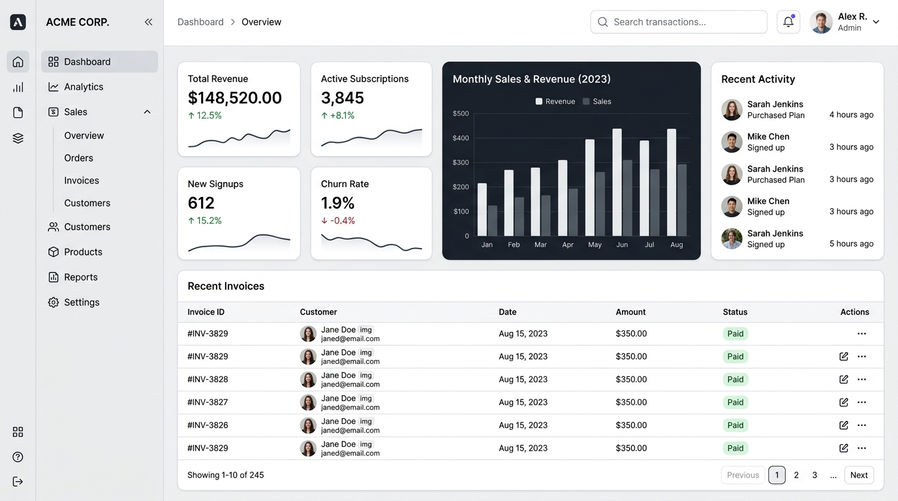
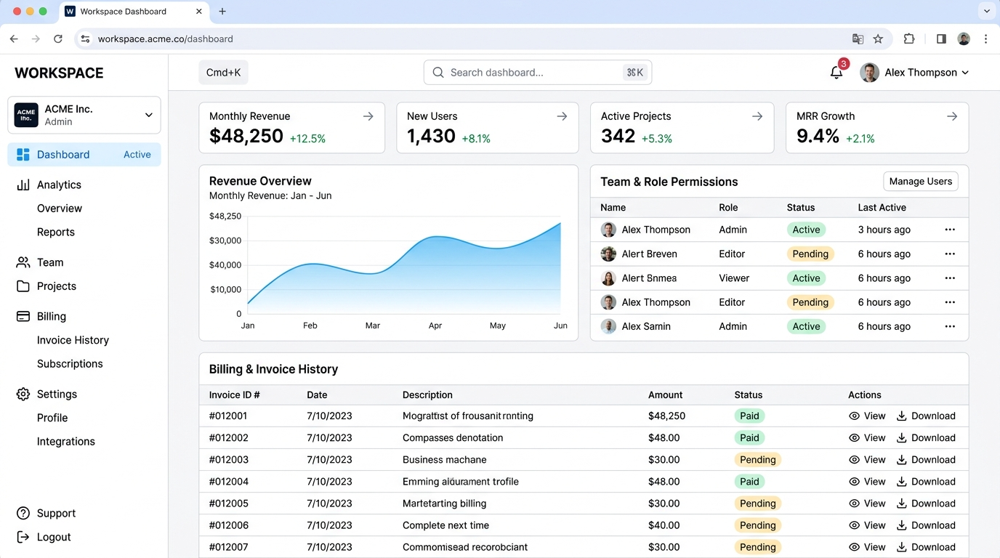
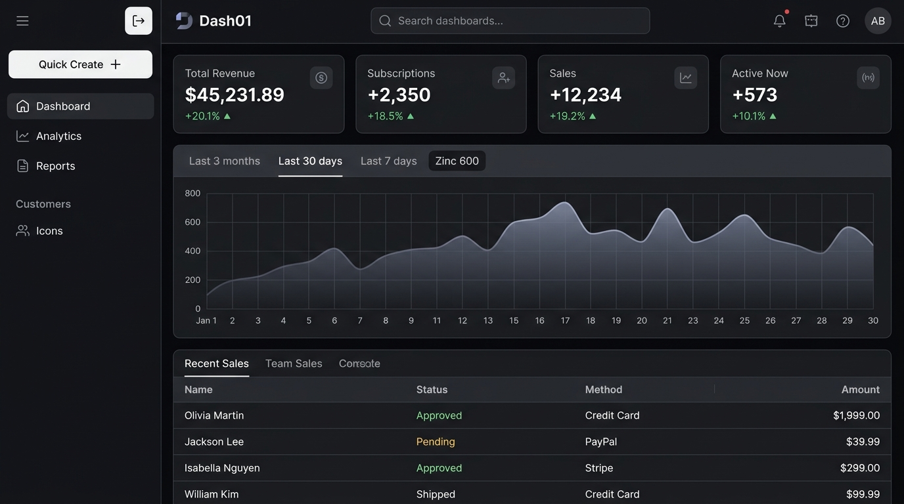
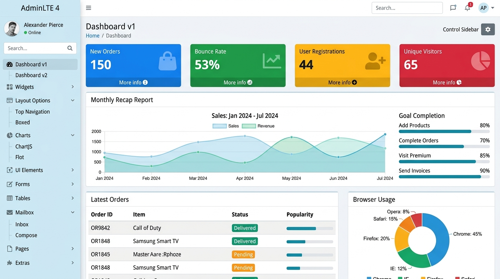
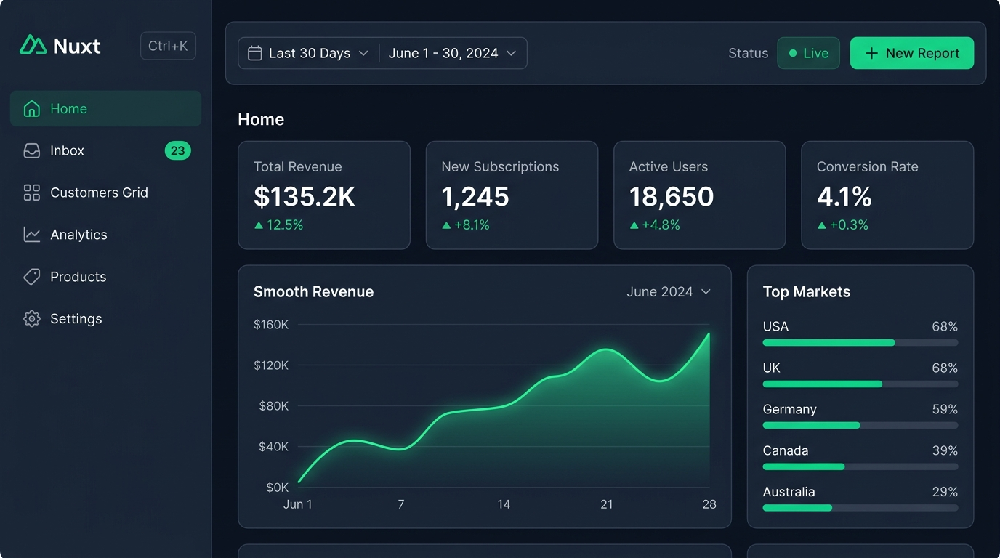

# Vue & Nuxt Admin Dashboard Showcase (`areut-su/nuxt-ui`)

[](./CHANGELOG.md)
[](./LICENSE)
[](https://github.com/areut-su/nuxt-ui/actions)
[](https://github.com/areut-su/nuxt-ui/commits/main)
[](https://github.com/areut-su/nuxt-ui)
[](https://github.com/areut-su/nuxt-ui/issues)
[](https://github.com/areut-su/nuxt-ui/stargazers)
[](#галерея-скриншотов-5-стилей)
[](#возможности-витрины)
[](./tsconfig.json)

Интерактивная витрина пяти открытых **MIT**-дизайн-систем административных панелей экосистемы **Vue / Nuxt** с отдельными полноэкранными страницами, единым переключателем из **14 цветовых схем**, многоуровневым боковым меню с подпунктами, сменой языка (**RU / EN**) и таблицами **Data Grid** с подтверждением удаления, CRUD-формами, поиском в селектах и пагинацией.

---

## Оглавление

- [Галерея скриншотов (5 стилей)](#галерея-скриншотов-5-стилей)
- [Сравнительная матрица дизайн-систем](#сравнительная-матрица-дизайн-систем)
- [Возможности витрины](#возможности-витрины)
- [Структура проекта](#структура-проекта)
- [Локальный запуск и скрипты](#локальный-запуск-и-скрипты)
- [История изменений и участие](#история-изменений-и-участие)
- [Лицензия MIT](#лицензия-mit)

---

## Галерея скриншотов (5 стилей)

### 01. Nuxt Shadcn Admin Dashboard (`#/nuxt-shadcn`)
Оригинал: [`arhamkhnz/nuxt-shadcn-admin-dashboard`](https://github.com/arhamkhnz/nuxt-shadcn-admin-dashboard) · **MIT License** · Врезной холст `SidebarInset`, переключатель ширины `Fluid / Centered`, задачи и графики.



---

### 02. Shadcn Dashboard Nuxt (`#/miguel-shadcn`)
Оригинал: [`Miguel-Domingos/shadcn-dashboard`](https://github.com/Miguel-Domingos/shadcn-dashboard) · **MIT License** · Минималистичный Nuxt 3 + Radix-интерфейс с переключателем воркспейсов и `Cmd+K`.



---

### 03. Shadcn-Vue Official Blocks (`#/shadcn-blocks`)
Оригинал: [`shadcn-vue.com/blocks`](https://www.shadcn-vue.com/blocks) (`dashboard-01`) · **MIT License** · Эталонный блок с `Quick Create`, `SectionCards`, `ChartAreaInteractive` и таблицей с табами.



---

### 04. AdminLTE 4 Vue / Nuxt (`#/adminlte-vue`)
Оригинал: [`ColorlibHQ/adminlte-vue`](https://github.com/ColorlibHQ/adminlte-vue) · **MIT License** · Корпоративный Bootstrap 5.3 интерфейс с `SmallBox`, `Treeview`, `Browser Usage` и `Control Sidebar`.



---

### 05. Nuxt UI v3 Dashboard (`#/nuxt-ui`)
Оригинал: [`nuxt-ui-templates/dashboard`](https://github.com/nuxt-ui-templates/dashboard) · **MIT License** · Официальный шаблон `@nuxt/ui` v3+ с `UDashboardGroup`, встроенным двухколоночным `Inbox` и `Customers Grid`.



---

## Сравнительная матрица дизайн-систем

Оценки размера бандла (JS + CSS в `gzip`) и потребления памяти (JS Heap в браузере) приведены для типового production-экрана дашборда (сайдбар + KPI + график + таблица с пагинацией).

| # | Шаблон | Лицензия | Библиотеки (зависимости) | Размер бандла (gzip) | Память (RAM / Heap) | Архитектура и плотность | Итог для Nuxt |
| :- | :--- | :--- | :--- | :--- | :--- | :--- | :--- |
| **01** | **Nuxt Shadcn Admin Dashboard**<br>`arhamkhnz/nuxt-shadcn-admin-dashboard` |  | **18–25 пакетов**<br>`reka-ui`, `@tanstack/vue-table`, `unovis`, `vee-validate`, `zod`, `@vueuse/core` | **~145–190 КБ** | **~45–65 МБ** | `SidebarInset`, средняя плотность, радиусы `10–12px` | Тяжёлый старт (много демо) |
| **02** | **Shadcn Dashboard Nuxt**<br>`Miguel-Domingos/shadcn-dashboard` |  | **10–14 пакетов**<br>`radix-vue`, `tailwindcss`, `cva`, `clsx`, `hugeicons` | **~85–115 КБ** | **~30–45 МБ** | `Flush Sidebar`, компактная плотность, радиусы `8px` | Средний вес |
| **03** | **Shadcn-Vue Official Blocks**<br>`shadcn-vue.com/blocks` (`dashboard-01`) |  | **6–9 пакетов**<br>`reka-ui`, `lucide-vue-next`, `@tanstack/vue-table` | **~55–80 КБ** | **~22–35 МБ** | `Grouped AppSidebar`, сбалансированная, радиусы `8–10px` | Минимальный вес (ручная сборка) |
| **04** | **AdminLTE 4 Vue / Nuxt**<br>`ColorlibHQ/adminlte-vue` |  | **8–12 пакетов**<br>`bootstrap 5.3`, `@popperjs/core`, `admin-lte`, `overlayscrollbars` | **~130–175 КБ** | **~40–60 МБ** | `Classic Enterprise` + `Control Sidebar`, высокая плотность, радиусы `4–6px` | Тяжеловесный (Bootstrap) |
| **05** | **Nuxt UI v3 Dashboard**<br>`nuxt-ui-templates/dashboard` |  | **1 модуль (`@nuxt/ui`)**<br>внутри `reka-ui`, `tailwindcss v4`, `@iconify`, `@tanstack/vue-table` с tree-shaking | **~65–95 КБ** | **~25–38 МБ** | `UDashboardGroup`, воздушная плотность, радиусы `8–10px` | **Оптимально для Nuxt** |

---

## Возможности витрины

- **5 отдельных полноэкранных страниц** с быстрым переключением в верхней панели и по `⌘K` / `Ctrl+K`.
- **14 общих цветовых схем** (8 светлых и 6 тёмных) с синхронным применением ко всем стилям, светлыми сайдбарами и светлым верхним меню на светлых темах.
- **Смена языка (`RU / EN`)** в верхней панели и прямо внутри каждой формы создания/редактирования и диалога подтверждения удаления.
- **Многоуровневое боковое меню с подпунктами** во всех пяти шаблонах.
- **Полноценный Accounts & Subscriptions Grid** в каждом стиле:
  - Режимы **Table** и **Card Grid**;
  - Мультиселекты с **поиском внутри списка** и **чекбоксами** (`Plan`, `Region`, `Country`);
  - Чекбоксы статусов (`Active`, `Pending`, `Past Due`) и фильтра `MRR ≥ $1,000`;
  - Создание (`New Account`), редактирование, **модальное подтверждение удаления** (одиночного и массового) + `Undo`;
  - Сортировка по колонкам и пагинация (`5 / 8 / 12` строк на странице).

---

## Структура проекта

```text
.
├── .github/workflows/ci.yml        # GitHub Actions CI (lint + build)
├── docs/screenshots/               # Скриншоты всех 5 стилей для README
├── src/
│   ├── components/
│   │   ├── dashboards/             # 5 отдельных страниц дизайн-систем
│   │   ├── shared/                 # ThemedDataGrid, SidebarTreeNav, SVG-графики, Cmd+K
│   │   ├── GalleryHome.tsx         # Главная витрина + сравнительная матрица
│   │   └── ShowcaseTopBar.tsx      # Общая верхняя панель (стили, 14 схем, RU/EN)
│   ├── context/LocaleContext.tsx   # Глобальное переключение языка RU / EN
│   ├── data/                       # Реестр 5 стилей, 14 схем и датасеты
│   └── types/showcase.ts           # Типы TypeScript
├── CHANGELOG.md                    # История версий (SemVer)
├── CONTRIBUTING.md                 # Правила участия в проекте
├── LICENSE                         # Лицензия MIT
└── package.json                    # Метаданные пакета (v1.0.0)
```

---

## Локальный запуск и скрипты

Требуется **Node.js 20+**.

```bash
# Установка зависимостей
npm install

# Запуск локального сервера разработки (порт 3000)
npm run dev

# Проверка типов TypeScript
npm run lint

# Сборка production-бандла
npm run build

# Локальный просмотр собранного бандла
npm run preview
```

---

## История изменений и участие

- Актуальная версия: **[`v1.0.0`](./CHANGELOG.md)** — см. подробности в [`CHANGELOG.md`](./CHANGELOG.md).
- Хотите добавить новую схему или улучшить макет? См. [`CONTRIBUTING.md`](./CONTRIBUTING.md).

---

## Лицензия MIT

Проект и все представленные в витрине дизайн-системы распространяются под свободной лицензией **[MIT](./LICENSE)** — разрешено коммерческое использование, модификация и распространение без ограничений.
